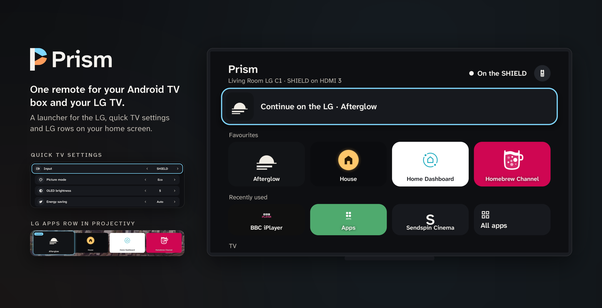
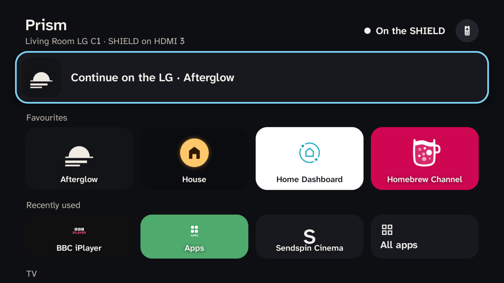
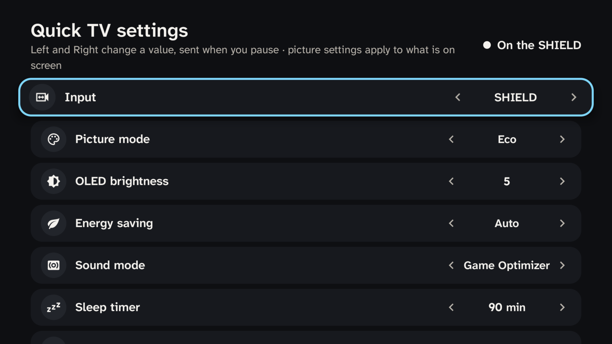
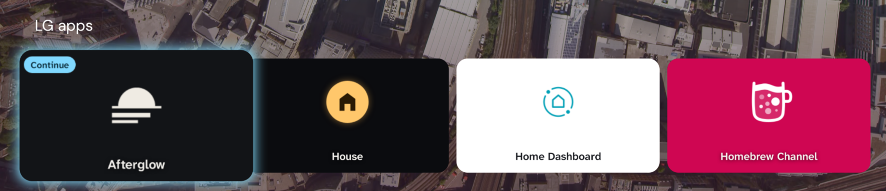

<p align="center">
  
</p>

# Prism

One remote for your Android TV box and your LG TV. While an LG app or menu is on screen, the box's remote drives
the LG: arrows, OK, Back, play/pause, rewind and fast-forward go to the TV through Home Assistant. When the box's
own input is on screen, the keys stay with the box as usual.

Prism is also a launcher for the LG, so you can open LG apps, LG Home, LG Settings and a few common TV settings
without picking up the LG remote.

> **Status:** an earlier private build of this app runs every day on an NVIDIA Shield with a rooted 2021 LG C1.
> Version 1.0.0 (the new package name, the Remotes page and opt-in monitoring) has only run in the host tests so
> far. Reports either way are very welcome.

## What it does

- **Follows the TV.** Prism watches the TV's active app in Home Assistant. When an LG app, LG Home or LG Settings
  is in front (even above the box's HDMI input), the remote's navigation keys go to the LG. When the box's input is
  back in front, they stay on the box.
- **Hold Back to come back.** Hold Back for 0.8 s while the remote drives the LG to switch the TV to the box's
  input. Home does the same, and still opens the box's home screen.
- **A launcher for the LG.** Your favourite LG apps as big tiles with their own LG icons, recently used apps, all
  apps, LG Home, LG Settings, and a "Continue on the LG" tile for the last LG app you used.
- **Quick TV settings.** Input, picture mode, OLED brightness, energy saving, sound mode, sleep timer and logo
  dimming, changed with Left and Right.
- **Home-screen rows.** Two Android TV channels, "LG apps" and "LG commands", for launchers that show apps'
  channels as rows (such as Projectivy).
- **The LG keyboard.** While the LG's on-screen keyboard is up, the remote drives it, and a keyboard's Delete and
  keypad Enter go to the LG keyboard's own keys.
- **You choose the remotes.** Setup → Remotes lists every input device that has pressed a key, each with a switch.

## Screenshots

From an NVIDIA Shield with a 2021 LG C1.

| The launcher | Quick TV settings |
|---|---|
|  |  |

The "LG apps" row on Projectivy's home screen, with the Continue card first:



## Requirements

- **An LG TV running webOS, rooted, with [Glasshouse](https://github.com/rorygallagher2024/glasshouse) and its Home
  Assistant MQTT bridge.** Prism uses Glasshouse's app IDs (#737), focused-window routing (#742) and icon server
  (#743), which are all in Glasshouse's main branch. Rewind and fast-forward need #758. LG keyboard support needs
  a Glasshouse change that isn't upstream yet; without it the keyboard part does nothing and everything else works.
- **Home Assistant** on your local network, with the TV's Glasshouse entities enabled (Launch App, Input Source,
  Active App and the Remote buttons).
- **An Android TV or Google TV box.** Tested on an NVIDIA Shield (Android 11). Android 8 or later.
- **For the home-screen rows**, a launcher that shows apps' channels as rows, such as Projectivy. The stock Google
  TV home screen doesn't.

## Install

Download `prism-<version>.apk` from [Releases](../../releases) and sideload it:

```bash
adb connect <box address>
adb install prism-1.0.0.apk
```

Or copy the APK to the box and open it with a file manager. To get updates automatically, add this repository to
[Obtainium](https://github.com/ImranR98/Obtainium).

## Set up

Open Prism on the box. Setup is one list; work down it.

1. **Home Assistant.** Create a local, non-admin user for the box in Home Assistant, sign in as it once, and make a
   long-lived access token on its profile page. Enter your Home Assistant address and the token. Prism needs only
   to read states, subscribe to them and call entity services; admin rights are never needed.
2. **TV.** Prism lists the Glasshouse TVs it finds in Home Assistant's registries. Entities are matched by their
   role, so renaming them in Home Assistant is fine, and Prism follows added or renamed entities on its own.
3. **The box's input** (for example "SHIELD input"). Prism reads which HDMI input the box is on from the TV.
   Nothing switches.
4. **Remote permission.** In the box's Settings → Device Preferences → Accessibility, turn on Prism. This is how it
   receives key presses while another app is open.
5. **Stay connected in sleep.** Android's Doze cuts apps off the network while the box sleeps, and Android TV has
   no screen to exempt an app. Run this once from a computer (it persists):

   ```bash
   adb shell dumpsys deviceidle whitelist +io.github.haydengriffin.prism
   ```

   Setup shows "Off · needs adb" until it's done.
6. **Follow the TV.** Turn it on, and the remote follows whatever the TV shows.

`tools/configure.py` can send the address and token from a computer over adb instead of typing the token with the
remote. It needs a debug build (`--help` for details).

### Remotes

Setup → Remotes lists every input device that has pressed a key since the permission was allowed, with its kind
and a switch for whether it controls the LG. Until you change a switch:

- **Physical** remotes (Bluetooth, USB, IR receivers) control the LG.
- **Virtual** devices are off. Phone remote apps and `adb shell input` show up as virtual; turn one on to drive the
  LG from your phone.

The TV's own remote, passed through to the box over HDMI-CEC, is listed without a switch: it can never control the
LG, because forwarding it would send the TV's presses back to the TV.

### Monitoring (optional)

Setup → Monitoring can write Prism's state and version (for example `lg · 1.0.0`) to an `input_text` helper of
your choice: when it connects, whenever the state changes, and every minute while the link is healthy. An
automation can then warn you when the value stops changing while the box is on. It's off by default, and nothing
is written until you turn it on. The Home Assistant user needs no extra rights for it.

## Using it

- **Keys.** With an LG app or menu in front, arrows, OK, Back, play/pause, rewind and fast-forward go to the LG.
  Home, power, volume and the mic button always stay with the box (for voice search on the LG, use the LG
  remote's own voice button).
- **Going back to the box.** Hold Back for 0.8 s, or press Home.
- **The launcher.** OK on a tile opens it on the LG, and the remote follows. Favourites are chosen in Setup →
  Favourites, in any order. The header's live line says where the remote is: "On the LG · BBC iPlayer", "On the
  SHIELD" (the box's own name, from Android's settings), "The TV is off", or the step that's failing.
- **Quick TV settings.** Left and Right step a value; it's sent after half a second, or when you leave the row.
- **Home-screen rows.** "LG apps" has the Continue card and your favourites; "LG commands" has LG Home, LG
  Settings, Quick TV settings and one "Switch to" card per TV input (Setup can hide this row). In Projectivy, add
  them in its settings for channels and rows; the exact menu path may differ between versions.
- **The LG keyboard.** When the LG asks for text, the remote drives its on-screen keyboard. A keyboard's Delete and
  keypad Enter press the LG keyboard's own keys.
- **Shortcuts for a button mapper.** Prism doesn't remap buttons itself, but a button mapper such as TvQuickActions
  can open its activities: `.OpenLgHome`, `.OpenLgSettings`, `.OpenQuickSettings`, or `.ShortcutActivity` with
  `--es target app:<LG app id>` (or `input:<input name>`, which switches the TV's input).
- **On-TV cue.** If Glasshouse's Screen Notification entity is enabled in Home Assistant, the first press of each
  LG session shows "Remote on the LG · hold Back for the SHIELD" on the TV.

How the routing works, including timings and what happens when the link drops, is in
[`docs/how-it-works.md`](docs/how-it-works.md).

## Privacy

- Prism uses accessibility for key filtering only. It can't read the screen, anything typed, or the microphone.
- It talks only to the Home Assistant you configure, and the TV's icon server, on your local network. No
  analytics, no other servers.
- The token is encrypted with a non-exportable Android Keystore key, excluded from backups and never logged. The
  page where you type it blocks screenshots and the recents thumbnail.
- The home-screen card images are served read-only to the launcher, and contain only app names and icons.

## Building

JDK 17 and the Android SDK command-line tools, with platform 36 and build-tools 36.0.0. There's no Gradle.

```bash
python3 tools/test.py               # host tests: routing, the link, the launcher, home-screen rows, remotes
python3 tools/build.py              # build/prism-<version>-debug.apk, signed with your Android debug key
python3 tools/build.py --release    # build/prism-<version>.apk, not debuggable, plus build/SHA256SUMS
```

`ANDROID_SDK_ROOT` and `JAVA_HOME` point at the SDK and JDK. A release build reads its signing key from
`PRISM_KEYSTORE` (the keystore's path), `PRISM_KEYSTORE_PASSWORD`, `PRISM_KEY_ALIAS` and `PRISM_KEY_PASSWORD`.
Keystores are git-ignored; never commit one.

Other tools: `tests/emulator_smoke.py` runs the APK on an Android emulator against a fake Home Assistant;
`tools/hero.py` draws the README hero and screenshots from screenshots taken on the box;
`tools/brand.py` draws the launcher icon, TV banner and social preview from the SVGs in
[`docs/brand/`](docs/brand) (written by `tools/brand_svg.py`; usage notes in its README); `tools/icons.mjs`
regenerates the icons from Material Design Icons; `tools/fonts.py` regenerates `res/font` from the variable fonts.

Pushing a `v*` tag builds a signed release on GitHub Actions and attaches the APK and `SHA256SUMS` to a GitHub
Release (see [`.github/workflows/release.yml`](.github/workflows/release.yml)).

## Limitations

- Prism controls one LG TV, and only one that runs Glasshouse. Stock webOS isn't supported.
- Every press is a Home Assistant service call, so how fast it feels depends on your network and Home Assistant.
  Held arrows repeat at most every 150 ms.
- Volume, power and the mic button are never taken. Use the box's own CEC volume, or the LG remote.
- The keyboard needs a Glasshouse change that isn't upstream yet.
- Projectivy's menu path for adding the rows hasn't been checked against every version.

## Credits

- [Glasshouse](https://github.com/rorygallagher2024/glasshouse) by Rory Gallagher does the hard part: it runs on the
  TV and puts it in Home Assistant.
- Fonts: Atkinson Hyperlegible Next (Braille Institute of America) and Lexend (The Lexend Project Authors), SIL Open
  Font License 1.1.
- Icons: [Material Design Icons](https://pictogrammers.com/library/mdi/), Apache License 2.0.

## Licence

[MIT](LICENSE), © 2026 Hayden Griffin. The bundled fonts and icons keep their own licences; see [NOTICE](NOTICE).
