# Prism brand

**The idea:** a P whose counter is a prism. A wedge of light opens from the prism through the bowl, so the bowl
leaves the stem as two arms. One stem is the box's one remote; the two arms are the two screens it drives:
sky for the LG (the app's colour for "the LG has the remote"), amber for the box.

## Files

All artwork is outlined SVG (no fonts needed). `tools/brand_svg.py` writes it; `tools/brand.py` turns it into
the app's icon, banner and PNGs. Change the artwork in `brand_svg.py`, then run both.

| File | Use |
|---|---|
| `prism-symbol.svg` | The mark in colour, for dark grounds |
| `prism-symbol-light.svg` | The mark in colour, for light grounds |
| `prism-symbol-black.svg`, `prism-symbol-white.svg` | One colour |
| `prism-lockup.svg` (dark grounds), `-light`, `-black`, `-white` | Mark + name, the primary logo |
| `prism-stacked.svg` | Mark above the name, for square spaces (dark grounds) |
| `prism-icon.svg` | App icon tile: the mark on night, 22 % corners |
| `prism-icon-small.svg` | Small-size cut of the tile for 16 and 32 px (heavier stem on the pixel grid) |
| `prism-adaptive-foreground.svg` | Android adaptive-icon foreground (108 grid, mark inside the 66 safe circle) |
| `prism-banner.svg` | Android TV banner, 320 × 180 |
| `prism-social.svg` | GitHub social preview, 2:1 |
| `png/` | `prism-icon-512.png`, `prism-icon-192.png`, `apple-touch-icon.png` (180), `favicon.ico` (16/32/48) |

The GitHub social preview is `docs/images/social.png`. Upload it under the repository's Settings → Social preview.

## Colour

| Name | HEX | RGB | Role |
|---|---|---|---|
| Night | `#0e0f12` | 14 15 18 | Ground for the colour mark; the icon tile; ink of the one-colour dark version |
| Warm white | `#f4f2ee` | 244 242 238 | The stem and the name on dark |
| Sky | `#80d8ff` | 128 216 255 | Top arm on dark (the LG) |
| Amber | `#ff9d5c` | 255 157 92 | Bottom arm on dark (the box) |
| Deep sky | `#1d8ac0` | 29 138 192 | Top arm on light grounds (3.9:1 on white) |
| Deep amber | `#d4632a` | 212 99 42 | Bottom arm on light grounds (3.7:1 on white) |
| Muted | `#b9b4ac` | 185 180 172 | Taglines on dark |

On light grounds the stem and name are night. Sky and amber are too pale on white (1.6:1 and 2.1:1), which is
why the light version uses the deep pair. Prism is screen-only; no CMYK or spot colours are defined.

**Approved pairs:** colour on night or any dark ground · light colour version on white or pale grounds · black on
light · white on dark or on photos (calm area). On a busy image, use the icon tile.

## Type

The name is Atkinson Hyperlegible Next SemiBold (the app's own font, SIL OFL 1.1), outlined, at the font's own
spacing. Taglines use Atkinson Hyperlegible Next Regular. Don't retype the name; use the files.

## Clear space and size

- **Clear space:** at least one stem width on every side (the stem is the P's upright, about a quarter of the
  symbol's width). More is better.
- **Minimum size:** the symbol 16 px tall (use `prism-icon-small.svg` for tiles at 32 px and below); the lockup
  96 px wide; below that, use the symbol alone.

## Don't

- Stretch, rotate, outline, shadow or add gradients.
- Swap the arm colours or recolour them outside this palette; keep sky on top.
- Close the wedge or the counter, or rearrange or resize the lockup's parts.
- Put the dark-ground colour version on white (the stem disappears); use `-light`.

## Test notes

Checked at 16, 32, 48 and 512 px, one-colour black and white, mirrored and rotated. The reversed white mark
looks no heavier than the black one at these sizes, so there's no separate thinned file. At 16 px the wedge closes
but the counter and the colour split still read; the small-size cut keeps the stem crisp. Trademark clearance has
not been checked.
